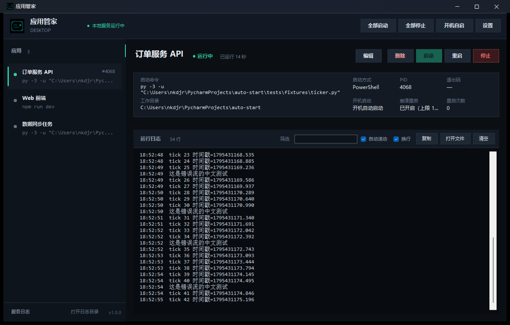

# 应用管家（Windows 桌面版）

一个原生的 Windows 桌面程序：管理你的 Python / Node 应用，开机后自动在托盘运行，随时查看状态和日志，支持启动、停止、重启。

不依赖浏览器、不需要 Node，运行管理器的电脑甚至不需要安装 Python（它只是帮你执行你配置的命令）。



## 功能

- **原生桌面窗口 + 系统托盘**：关闭窗口只是最小化到托盘，应用继续运行
- **开机自启**：内置计划任务安装器，支持“登录后启动（无需管理员）”和“开机时启动（SYSTEM，需要一次管理员）”
- **托管任意命令行应用**：Python、Node、npm、uvicorn、exe 都可以
- **启动 / 停止 / 重启 / 全部启动 / 全部停止**：停止时结束整个进程树
- **实时日志**：筛选、复制、打开日志文件、自动滚动、自动换行、清空
- **崩溃自动重启**：2s、4s、8s… 退避，默认最多 10 次；稳定运行 2 分钟后计数归零
- **独立环境**：每个应用单独配置工作目录、环境变量、启动延迟、PowerShell / CMD
- **完全本地**：桌面版不监听任何端口，不联网
- **单文件 exe**：`AppManagerDesktop.exe`，无需安装运行时（Windows 10/11 自带 .NET Framework 4.8）

## 快速开始

1. 双击 `AppManagerDesktop.exe`（或 `desktop.cmd` / `start-manager.cmd`）
2. 点左侧「+ 添加」，填写应用名称、启动命令、工作目录
3. 勾选「开机后自动启动」和「异常退出后自动重启」
4. 点右上角「开机自启」→ 选择模式 → 开启

以后重启电脑，程序会安静地启动到系统托盘，并拉起所有勾选了开机启动的应用。

## 添加应用的例子

**Python 项目（虚拟环境）**

| 字段 | 内容 |
| --- | --- |
| 应用名称 | 订单 API |
| 启动命令 | `.\.venv\Scripts\python.exe -m uvicorn main:app --host 0.0.0.0 --port 8000` |
| 工作目录 | `C:\projects\order-api` |
| 启动方式 | PowerShell |

**Node 项目**

| 字段 | 内容 |
| --- | --- |
| 应用名称 | Web 前端 |
| 启动命令 | `npm run start` |
| 工作目录 | `C:\projects\web` |

**注意事项**

- 命令必须是**前台运行**。不要用 `start`、`Start-Process`、`pm2 start -d` 转到后台，否则管家会认为进程已经退出。
- 以引号开头的完整路径会自动加上 PowerShell 的 `&` 调用运算符，可以直接粘贴。
- 修改正在运行的应用配置后，新配置在下次启动时生效。

## 开机自启

面板右上角「开机自启」：

| 模式 | 权限 | 说明 |
| --- | --- | --- |
| 开机时启动（推荐） | 需要管理员一次 | 以 SYSTEM 运行，不需要登录 Windows，适合服务器 |
| 用户登录后启动 | 普通权限即可 | 使用当前用户环境，适合依赖用户级 PATH 的项目 |

任务名：`AppManagerDesktop`，动作：`AppManagerDesktop.exe --minimized`（启动后只显示托盘图标）。

两种模式都已在 Windows 11 上实际验证：普通权限可以注册并运行“登录后启动”任务；“开机时启动”会弹出一次 UAC 授权，这是 Windows 本身的限制。

移除：同样的窗口里点「移除自启」。

> SYSTEM 模式下找不到 node / npm 时，在「设置 → 额外 PATH」填入 Node 安装目录（例如 `C:\Program Files\nodejs`），或改用登录后启动。

## 托盘与退出

- 点窗口右上角 ×：最小化到托盘，应用继续运行
- 双击托盘图标：重新打开窗口
- 托盘右键：打开面板 / 全部启动 / 全部停止 / 退出
- 「退出」会先停止所有应用，再关闭程序

## 日志

- 每个应用：`logs\<应用ID>.log`
- 管家自身：`logs\_manager.log`，窗口左下角「服务日志」可查看
- 单文件超过 5MB 自动轮转，保留 3 份
- 输出统一按 UTF-8 采集；老程序输出 GBK 也能自动识别。Python 子进程默认开启 `PYTHONUNBUFFERED` 和 `PYTHONUTF8`，中文不乱码、输出不延迟

## 配置文件

程序目录下的 `config.json`，面板里改的设置都会写到这里：

```jsonc
{
  "port": 8787,                // 仅 Web 版使用，桌面版忽略
  "startup_delay": 3,          // 开机后等待多少秒再拉起应用
  "extra_path": "",            // 追加到 PATH 的目录
  "env": {},                   // 全局环境变量
  "apps": [
    {
      "id": "order-api",
      "name": "订单 API",
      "command": ".\\venv\\Scripts\\python.exe app.py",
      "cwd": "C:\\projects\\order-api",
      "shell": "powershell",
      "env": { "PORT": "8000" },
      "auto_start": true,
      "restart_on_crash": true,
      "start_delay": 0,
      "max_restarts": 10,
      "max_log_lines": 2000
    }
  ]
}
```

## 目录结构

```
auto-start/
├─ AppManagerDesktop.exe      桌面版主程序（双击即可）
├─ config.json                配置
├─ desktop/                   桌面版源码和构建脚本
│  ├─ Core.cs                 配置、进程管理、日志
│  ├─ Ui.cs                   主界面、托盘
│  ├─ Dialogs.cs              添加/设置/自启/日志窗口
│  ├─ build-desktop.ps1       一键编译
│  ├─ app.manifest            应用清单
│  ├─ app.ico                 图标
│  └─ tests/                  核心逻辑测试
├─ desktop.cmd / start-manager.cmd   启动桌面版
├─ logs/                      日志
├─ run/                       每次启动生成的临时脚本（便于排查）
├─ manager.py / web/          可选：Web 远程版
└─ start-web.cmd              可选：启动 Web 版
```

## 从源码编译

只需要 Windows 自带的 .NET Framework 编译器，不需要安装 Visual Studio / .NET SDK：

```powershell
powershell -ExecutionPolicy Bypass -File desktop\build-desktop.ps1
```

运行核心逻辑测试：

```powershell
powershell -ExecutionPolicy Bypass -File desktop\build-desktop.ps1 -Test
desktop\tests\CoreTests.exe "C:\path\to\auto-start"
```

测试覆盖 21 项：配置初始化、启动、中文日志、环境变量、停止、重启换 PID、日志落盘、崩溃自动拉起、重启上限、CMD 模式、配置持久化、清空日志、删除应用。

## 可选：Web 远程版

如果你还想从别的电脑通过浏览器查看，目录里保留了原来的 Web 版：

```powershell
start-web.cmd
```

访问 `http://127.0.0.1:8787`。它的自启任务名是 `AppManager`，与桌面版互不相同。

> 桌面版和 Web 版不要同时运行，它们管理同一份 `config.json`，会重复启动应用。桌面版启动时如果检测到 Web 版在运行，会直接提示并退出。

## 常见问题

**开机后没有自动运行**
1. 打开「任务计划程序」，查看 `AppManagerDesktop` 是否存在、上次运行结果
2. 看 `logs\_manager.log`
3. 移动过程序目录后，需要重新安装一次开机自启（任务里记录的是绝对路径）

**找不到 node / npm**
在「设置 → 额外 PATH」填 Node 目录；如果使用 SYSTEM 模式且 Node 是用户目录安装的，建议改用「登录后启动」。

**应用显示已停止，但没有日志**
命令可能立刻退出了，或者用了后台启动方式。检查启动命令、工作目录，以及日志里的报错。

**关闭窗口后应用还在跑吗**
在跑。× 只是最小化到托盘；要停止应用并退出，请用托盘菜单的「退出」。

**为什么不用 Electron / 浏览器套壳**
这是一个原生 WinForms 程序，启动快、内存小、只有一个 exe，不需要 Node 运行时，也不依赖浏览器。开机自启只启动这一个进程，窗口关掉也不影响后台应用。
